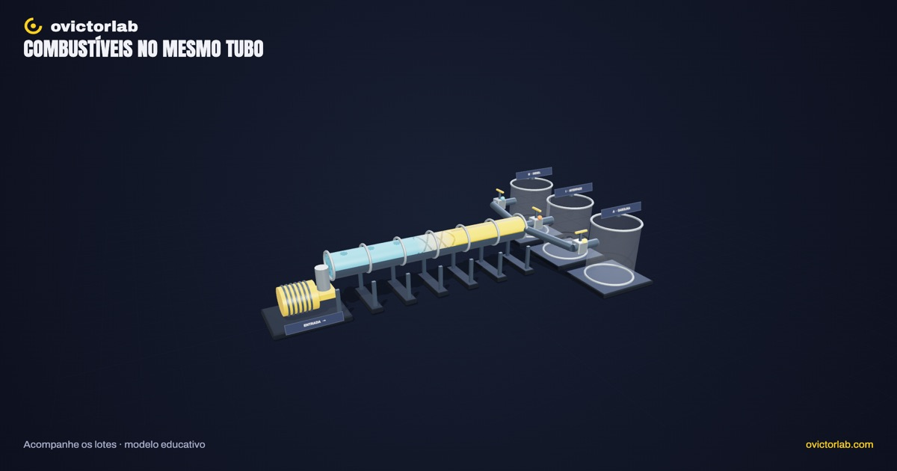
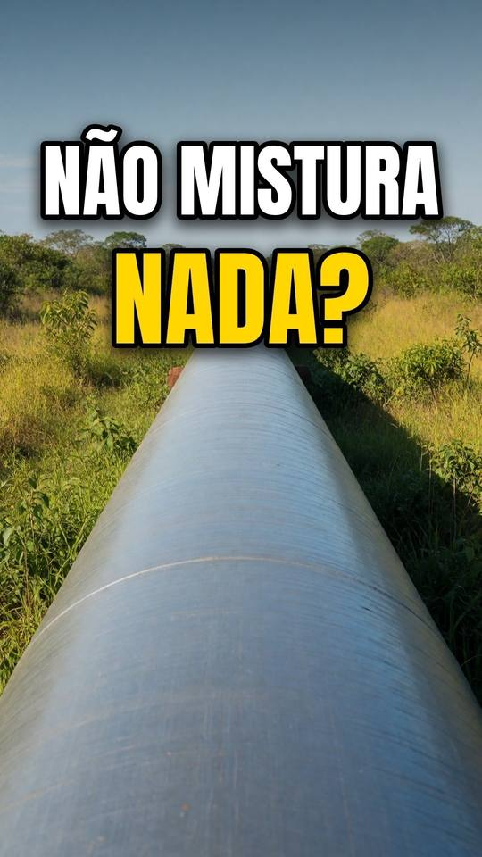

# Oleoduto: combustíveis no mesmo tubo

**[Abrir a experiência →](https://victorsodre.github.io/oleoduto/)** · [Os 10 experimentos](docs/COLECAO.md) · [Publicação e manutenção](docs/PUBLICACAO.md)

[](https://victorsodre.github.io/oleoduto/)

**Como gasolina e diesel passam pelo mesmo tubo?**

Um trecho de duto com dois lotes, uma região de interface (ou um selo de QINTER), um densímetro na chegada e um terminal de recebimento. A visualização explica o processo sem se apresentar como simulador operacional.

Direção e autoria editorial: **Victor Sodré / ovictorlab**. [Site](https://ovictorlab.com/) · [Referência Fusquinha](https://victorsodre.github.io/fusquinha/) · [Repositório](https://github.com/victorsodre/oleoduto).

## Entenda no vídeo

<a href="https://www.youtube.com/watch?v=BM1JQSVafug"></a>

**[O truque químico para separar gasolina e diesel no duto 🧪 #ciencia #engenharia](https://www.youtube.com/watch?v=BM1JQSVafug)**

Veja como os combustíveis seguem pelo mesmo duto. Depois, volte ao experimento para acompanhar os lotes e escolher os destinos.

O player incorporado fica [na página do experimento](https://victorsodre.github.io/oleoduto/#video), com carregamento por clique e sem reprodução automática.

## Por que desenvolver

O Reel do tema registrou 37.151 visualizações, 137 salvamentos e 557 compartilhamentos no Instagram. Consulta em 07/11/2026. Métricas acumuladas são sinais de interesse; não comprovam demanda pelo aplicativo ou alcance orgânico.

- [Combustíveis no mesmo tubo — Instagram](https://www.instagram.com/reel/Dem0z-nCbFI/)
- [Combustíveis no mesmo tubo — YouTube](https://www.youtube.com/watch?v=BM1JQSVafug)

## Começar por aqui

1. [Escopo e critérios de conclusão](docs/ESCOPO.md).
2. [Lista de execução](docs/EXECUCAO.md).
3. [Identidade visual do ovictorlab](docs/IDENTIDADE-VISUAL.md).
4. [Arquitetura proposta e reaproveitamento do Fusquinha](docs/ARQUITETURA.md).
5. [Assets, fontes e pendências de apuração](docs/ASSETS-E-FONTES.md).
6. [Manutenção, validação e publicação](docs/MANUTENCAO.md).
7. [Decisões e estado do projeto](docs/DECISOES.md).
8. [Textos para o X](POSTAGENS-X.md) e [ordem da coleção](docs/COLECAO.md).

## Executar e verificar

Node.js 22.18+ e npm. Dependências fixadas no lockfile.

```sh
npm ci --ignore-scripts
npm run dev
npm test
npm run check
npm run build
npm run preview
```

`dist/` funciona como site estático, também em subpasta. Sem backend, LLM ou alocação da GPU de produção.

## Recursos entregues

Terminal 3D autoral com dez conjuntos: entrada/bomba, duto, gasolina, interface ou selo, diesel, densímetro, válvulas e três tanques. Fluxo determinístico, avanço manual, pausa, reset e escolha de destino com histórico. No automático, o densímetro troca a válvula no meio da mistura e cada metade vai para o tanque do produto vizinho, como no OSBRA. A seção "O truque do vídeo" alterna contato direto e selo de QINTER, com a curva do densímetro e seis fatos com fonte. O balanço conserva as 100 unidades ilustrativas e mostra a origem dos volumes em cada tanque.

Órbita, zoom, corte, busca, seleção por lista/clique, isolamento, desmontagem, malha, visita guiada e PNG 16:9/9:16 com a marca ovictorlab. Sem áudio neste tema.

Referências: Transpetro (CGS Dutos Longos, rev. 05), Martinoia (PUC-Rio, 2016), Tepedino et al. (2007), Kotchetkoff Neto (UFU, 2009) e SPOLM (2010), as mesmas da pesquisa do EP284. A região do meio está ampliada e o ponto de corte é ilustrativo; não representa vazões ou dimensões reais.

## Evidência

[Validação e limites](docs/VALIDACAO.md): testes aprovados (16 na revisão de 09/11/2026), check/build aprovados, 22 verificações de fluxo no Chrome, composição visual em desktop e viewport móvel, exportações e build estático em subpasta. Sem ensaio em telefone físico.

[Manutenção](docs/MANUTENCAO.md), [fontes e licenças](docs/ASSETS-E-FONTES.md), [decisões](docs/DECISOES.md). Os rascunhos do X permanecem sem envio.
